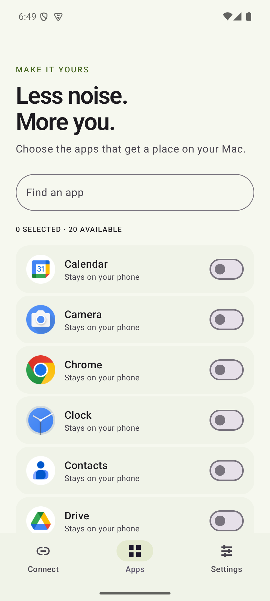

# Kunnect

Your Android notifications, on your Mac. A small native companion pair using your existing Tailscale network.

<p>  </p>

## What it does

- Native Android app using Jetpack Compose and Material 3 Expressive: large rounded surfaces, expressive theme and motion, wallpaper colors, light/dark appearance.
- Native Mac menu bar companion with settings, pause/resume, launch at login, test notification, and pairing reset.
- App allowlist, live notification updates, and removal in both directions.
- Per-app control over whether a Mac dismissal also dismisses on Android.
- Optional hidden message content and Mac notification sound (off by default).
- Authenticated connection to one phone; Android Keystore and macOS Keychain protect the pairing key.
- No Kunnect backend, analytics, notification archive, or polling for notification changes.

## Install and pair

Download `Kunnect-Android.apk` and `Kunnect-macOS-arm64.zip` from [Releases](https://github.com/BriskAM/kunnect/releases).

1. Install the APK on Android 9 or newer. On sideloaded apps, Android may require **App info → ⋮ → Allow restricted settings** before granting notification access.
2. Unzip and move `Kunnect.app` to `/Applications` on an Apple Silicon Mac running macOS 13 or newer. This initial personal build is ad-hoc signed, not Apple notarized. Use macOS **Privacy & Security → Open Anyway** if Gatekeeper blocks the downloaded app.
3. Connect both devices to the same Tailscale tailnet. Your tailnet policy must allow the phone to reach the Mac on **TCP port 41691**. No exit node or Tailscale Serve setup is required.
4. Open Kunnect from the Mac menu bar and allow notifications. Copy the Mac's **Tailscale IPv4** (`100.64.x.x`–`100.127.x.x`) from Tailscale if it is not detected automatically, plus the pairing key from Kunnect.
5. In Android Kunnect, enable notification access, enter those details, and select the apps you want to mirror. Tap **Start syncing** if needed.
6. Keep Tailscale running on both devices. Kunnect uses an Android foreground service with a persistent connection notification. Start it manually after a phone reboot. A Mac asleep or offline cannot receive live notifications.

The Android connection stays available with the app screen closed. Some phone manufacturers' battery restrictions and Android Doze can still delay network access. The app links to battery settings; it does not hold a wake lock or silently change battery settings.

## Notification behavior

Android is the source of truth. New or updated notifications are mirrored; removing one on Android removes its Mac copy. An explicit Mac dismissal requests removal of that exact Android notification revision. A newer message is never dismissed by an older request.

Use the notification's **Dismiss on both devices** action for predictable Mac-to-phone removal. Native explicit dismissal callbacks are also handled. A banner timing out or being flicked away is not necessarily an explicit dismissal; macOS clear/group gestures require testing on each OS version. Closing a notification does not mark a message as read. Protected/ongoing Android notifications and apps set to local-only dismissal stay on the phone.

While disconnected, the phone keeps no extra backlog. On reconnect it sends currently active, selected notifications and suppresses sounds during reconciliation. macOS still controls banners, Focus, grouping, and notification previews. A Mac dismissal can be retried for up to ten minutes in the current Mac process, and only if the Android revision still matches. Pending requests are not persisted across app exits.

Android can redact sensitive notification content, including OTPs. Notification access also depends on user/work-profile policies. This app does not bypass those restrictions. Notification text is bounded to 4,000 characters and each snapshot to 256 notifications.

## Efficiency and security

Android initiates one persistent TCP connection through Tailscale. Notification callbacks drive updates; a 150 ms debounce combines bursts, and only changed/removed records cross the connection after the initial snapshot. The idle reader blocks; the sender sends a small heartbeat every 30 seconds. Reconnection backs off from one to 30 seconds. No wake locks, HTTP polling, embedded VPN stack, or message database are used.

The wire format is newline-delimited JSON. **It relies on Tailscale for transport encryption**; it is not an additional application-layer encryption scheme. Production Android only connects to a numeric Tailscale IPv4 address. The Mac accepts tailnet IPv4 or local loopback peers, requires a random 256-bit key, and binds the first authenticated phone identity. It refuses ordinary LAN/public-IP clients. It listens on all local interfaces to work with Tailscale's macOS networking variants; source checks and pairing authentication are enforced before notification data is accepted. Restrict the port with tailnet grants/ACLs as appropriate.

Debug Android builds additionally permit `127.0.0.1` for isolated emulator tests. The signed release does not. Tokens are never logged. Android stores no notification content on disk; macOS Notification Center retains its usual system-managed history. Other apps and the operating systems already have their own notification records.

## Build

Requirements: JDK 17, Android SDK platform 37.0/build tools 36, and Swift 5.9+ with macOS developer tools. Gradle is pinned by the wrapper. SDK location goes in ignored `android/local.properties` or `ANDROID_HOME`.

```sh
./android/gradlew -p android :app:assembleDebug
./scripts/build-macos.sh
```

The Mac script creates an ad-hoc signed `.app` and ZIP in `output/`, targeting the build machine's architecture. The published ZIP is arm64.

For a signed Android release:

```sh
python3 scripts/create-signing-key.py
./scripts/build-android.sh
```

Back up **both** `~/.local/share/kunnect/release.keystore` and ignored `android/keystore.properties` securely. Future Android updates need this same signing identity. Neither is committed to GitHub. The release script enables R8 code and resource shrinking.

## Test

```sh
# Quit the Mac app first, so the wire check can bind port 41691.
./scripts/test-macos.sh

# Start an Android emulator, then:
./scripts/test-android.sh
python3 scripts/capture-android.py
```

The `fixture` module is an isolated notification generator for emulator tests. It is not bundled in the shipped app. See [test results and limits](docs/TESTING.md) and [wire protocol](docs/PROTOCOL.md). GitHub Actions checks both platforms on every push.

## Current scope

One phone and one Mac, IPv4 tailnet addressing, notification mirroring and dismissal. No SMS-history permission, reply sending, file transfer, clipboard sync, cloud relay, or account system. This is a first personal-use prerelease; real-device battery life and cross-network Tailscale behavior need a hardware acceptance pass.
