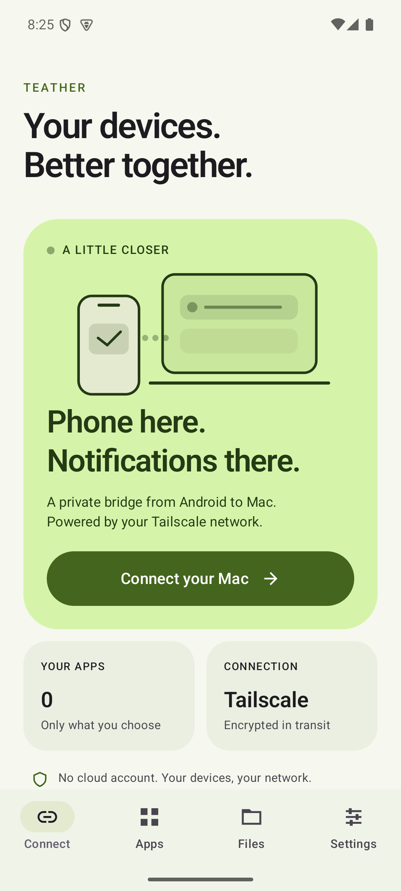
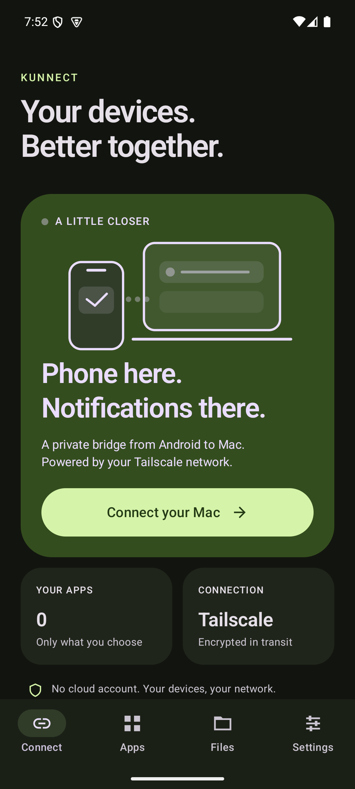

# Kunnect

Your Android notifications, on your Mac. A small native companion pair using your existing Tailscale network.

<p>  </p>

## What it does

- Native Android app using Jetpack Compose and Material 3 Expressive: large rounded surfaces, expressive theme and motion, wallpaper colors, light/dark appearance.
- Native Mac menu bar companion with settings, pause/resume, launch at login, test notification, and pairing reset.
- App allowlist, live notification updates, and removal in both directions.
- A chosen Android folder mounted as a native WebDAV volume in Finder, read-only by default with a separate write-access switch. No FUSE driver.
- Drag-to-Applications DMG installer and optional Android battery-optimization exemption prompt.
- Per-app control over whether a Mac dismissal also dismisses on Android.
- Optional hidden message content and Mac notification sound (off by default).
- Authenticated connection to one phone; Android Keystore and macOS Keychain protect the pairing key.
- No Kunnect backend, analytics, notification archive, or polling for notification changes.

## Install and pair

Download `Kunnect-Android.apk` and `Kunnect-macOS-arm64.dmg` from [Releases](https://github.com/BriskAM/kunnect/releases).

1. Install the APK on Android 9 or newer. On sideloaded apps, Android may require **App info → ⋮ → Allow restricted settings** before granting notification access.
2. Open the DMG and drag `Kunnect.app` onto the **Applications** shortcut on an Apple Silicon Mac running macOS 13 or newer. This initial personal build is ad-hoc signed, not Apple notarized. Use macOS **Privacy & Security → Open Anyway** if Gatekeeper blocks the downloaded app.
3. Connect both devices to the same Tailscale tailnet. Your tailnet policy must allow the phone to reach the Mac on **TCP port 41691**. No exit node or Tailscale Serve setup is required.
4. Open Kunnect from the Mac menu bar and allow notifications. Copy the Mac's **Tailscale IPv4** (`100.64.x.x`–`100.127.x.x`) from Tailscale if it is not detected automatically, plus the pairing key from Kunnect.
5. In Android Kunnect, enable notification access, enter those details, and select the apps you want to mirror. Tap **Start syncing** if needed.
6. Keep Tailscale running on both devices. Kunnect uses an Android foreground service with a persistent connection notification. Start it manually after a phone reboot. A Mac asleep or offline cannot receive live notifications.

## Android folder as a Mac disk

1. In Android Kunnect, open **Files → Choose folder**. Android grants access only to that directory and its descendants. Some storage roots and app-private locations cannot be selected.
2. Turn on **Share with your Mac**. Keep Kunnect and Tailscale running. The phone must allow incoming Tailscale connections from your paired Mac on **TCP 41692**, in addition to phone → Mac TCP 41691 for the notification connection. If Tailscale's “shields up” mode is enabled on Android, incoming file access will be blocked.
3. In the Mac menu bar, choose **Mount Android folder**, or use **Mount in Finder** in settings. It appears as a network volume in Finder and under `/Volumes`. Only mount when you need it; nothing is mirrored or scanned in advance.
4. Access is **read-only by default**. To create, replace, move, or delete files, explicitly enable **Allow changes from Mac** on Android and then eject/remount the volume on Mac. Revoking write access is enforced immediately by Android, even before remounting.
5. Eject from Kunnect or Finder when finished. **Stop sharing & forget folder** on Android stops the endpoint and releases its persisted folder grant.

The endpoint is authenticated with the pairing key and restricted to the paired Mac's Tailscale IPv4 address. Tailscale supplies encryption. Files stream in 64 KiB buffers, with at most four request workers; there is no background tree traversal, sync queue, file watcher, or file-server heartbeat. macOS/Finder can issue its own metadata and preview requests while a volume is mounted, so eject it when idle if battery usage is the priority.

Use a local device folder for predictable behavior. Cloud document providers can involve their own downloads and battery use. SAF is a document API, not a full POSIX filesystem: Finder extended attributes/timestamp updates and recursive server-side directory copying are not supported. Moving between directories requires provider support; renaming over an existing destination is refused rather than silently deleting it. Uploads are staged before replacing existing files. Providers do not offer a universal atomic-replace primitive, so a process/device crash during commit can leave a `.kunnect-upload-*` or `.kunnect-backup-*` recovery file. Do not use the network volume for databases, app bundles, or workloads requiring local-disk locking/atomicity.

## Battery and background access

The first connection offers an optional **Keep Kunnect reachable?** prompt. Choose **Keep system default** to continue without an exemption, or **Allow background access** to open Android's system consent dialog. The Settings screen shows exemption status and allows requesting it later. Kunnect never silently disables battery optimization.

An exemption improves availability during idle/Doze; it **does not reduce battery consumption**. Low idle work comes from event-driven notification updates, two-minute idle heartbeats, retries backing off up to two minutes, no wake locks, and on-demand file access. Real drain also depends on Tailscale, radio conditions, notification frequency, Finder requests, and transfers; no percentage-per-hour claim has been established on a physical phone.

The Android connection stays available with the app screen closed. Some phone manufacturers' battery restrictions and Android Doze can still delay network access. The exemption is optional; Kunnect does not hold a wake lock or silently change battery settings.

## Notification behavior

Android is the source of truth. New or updated notifications are mirrored; removing one on Android removes its Mac copy. An explicit Mac dismissal requests removal of that exact Android notification revision. A newer message is never dismissed by an older request.

Use the notification's **Dismiss on both devices** action for predictable Mac-to-phone removal. Native explicit dismissal callbacks are also handled. A banner timing out or being flicked away is not necessarily an explicit dismissal; macOS clear/group gestures require testing on each OS version. Closing a notification does not mark a message as read. Protected/ongoing Android notifications and apps set to local-only dismissal stay on the phone.

While disconnected, the phone keeps no extra backlog. On reconnect it sends currently active, selected notifications and suppresses sounds during reconciliation. macOS still controls banners, Focus, grouping, and notification previews. A Mac dismissal can be retried for up to ten minutes in the current Mac process, and only if the Android revision still matches. Pending requests are not persisted across app exits.

Android can redact sensitive notification content, including OTPs. Notification access also depends on user/work-profile policies. This app does not bypass those restrictions. Notification text is bounded to 4,000 characters and each snapshot to 256 notifications.

## Efficiency and security

Android initiates one persistent TCP connection through Tailscale. Notification callbacks drive updates; a 150 ms debounce combines bursts, and only changed/removed records cross the connection after the initial snapshot. The idle reader blocks; the sender sends a small heartbeat every two minutes. Reconnection backs off from one to 120 seconds. No wake locks, HTTP polling, embedded VPN stack, or message database are used.

The wire format is newline-delimited JSON. **It relies on Tailscale for transport encryption**; it is not an additional application-layer encryption scheme. Production Android only connects to a numeric Tailscale IPv4 address. The Mac accepts tailnet IPv4 or local loopback peers, requires a random 256-bit key, and binds the first authenticated phone identity. It refuses ordinary LAN/public-IP clients. It listens on all local interfaces to work with Tailscale's macOS networking variants; source checks and pairing authentication are enforced before notification data is accepted. Restrict the port with tailnet grants/ACLs as appropriate.

Debug Android builds additionally permit `127.0.0.1` for isolated emulator tests. The signed release does not. Tokens are never logged. Android stores no notification content on disk; macOS Notification Center retains its usual system-managed history. Other apps and the operating systems already have their own notification records.

## Build

Requirements: JDK 17, Android SDK platform 37.0/build tools 36, and Swift 5.9+ with macOS developer tools. Gradle is pinned by the wrapper. SDK location goes in ignored `android/local.properties` or `ANDROID_HOME`.

```sh
./android/gradlew -p android :app:assembleDebug
./scripts/build-macos.sh
```

The Mac script creates an ad-hoc signed `.app`, drag-to-install DMG, and ZIP in `output/`, targeting the build machine's architecture. The published Mac artifacts are arm64. The DMG build uses a local Python virtual environment with pinned `ds-store`/`mac-alias` packages to set Finder layout without Accessibility automation.

For a signed Android release:

```sh
python3 scripts/create-signing-key.py
./scripts/build-android.sh
```

Back up **both** `~/.local/share/kunnect/release.keystore` and ignored `android/keystore.properties` securely. Future Android updates need this same signing identity. Neither is committed to GitHub. The release script enables R8 code and resource shrinking.

## Test

```sh
# Quit the Mac app first, so the wire check can bind port 41691.
./scripts/test-macos.sh

# Start an Android emulator, then:
./scripts/test-android.sh
python3 scripts/capture-android.py

# On Mac, exercise a real native volume backed by the emulator:
./scripts/test-mounted-folder.sh
```

The `fixture` module is an isolated notification generator for emulator tests. It is not bundled in the shipped app. See [test results and limits](docs/TESTING.md) and [wire protocol](docs/PROTOCOL.md). GitHub Actions checks both platforms on every push.

## Current scope

One phone and one Mac, IPv4 tailnet addressing, notification mirroring/dismissal, and one scoped folder mounted on demand. No SMS-history permission, reply sending, automatic file synchronization, clipboard sync, cloud relay, or account system. This is a first personal-use prerelease; real-device battery life and cross-network Tailscale behavior need a hardware acceptance pass.
